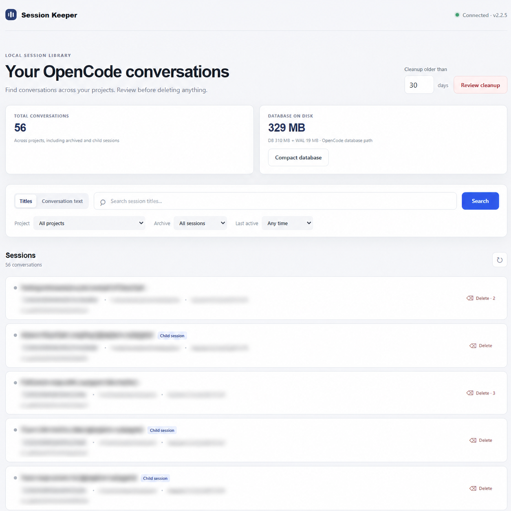
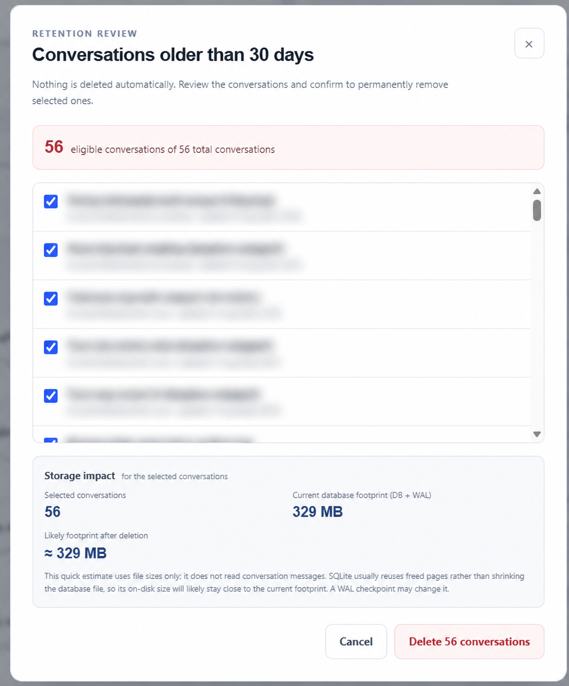
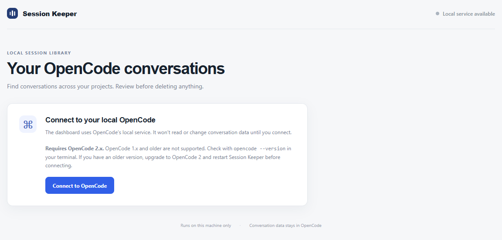

# OpenCode Session Keeper

A local dashboard for OpenCode 2 to search conversations, review session cleanup, and compact your database with backups.

**Requires OpenCode 2.x. OpenCode 1.x and older are not supported.** Runs locally on Windows and macOS.

## Find your conversations

Search titles or conversation text, filter by project and archive status, and see your database footprint at a glance.



## Review before deleting

Choose a retention period, review eligible conversations, and confirm what to remove. Active conversations and their ancestors are protected. Deleting a parent also deletes its child conversations.



Nothing is deleted automatically. Deletion is permanent. Database compaction creates a backup and verifies database integrity and conversation counts; it temporarily stops and restarts OpenCode.

*Conversation details in these screenshots are obscured for privacy.*

## Run locally

Install **Node.js 24.15+** and **OpenCode 2.x**, with the OpenCode CLI on your PATH. Check your version:

```sh
opencode --version
```

If you have OpenCode 1.x or older, upgrade to OpenCode 2 and restart Session Keeper before connecting.

```sh
npm install
npm run dev
```

Open <http://127.0.0.1:4173> and select **Connect to OpenCode**.

<details>
<summary>See the connection screen</summary>



</details>

The dashboard listens on loopback only and is intended for use on your own machine.

## Database and search notes

- Conversation text search scans user prompts and assistant replies on demand. Large histories take longer; reasoning and tool output are excluded.
- Deleting conversations usually frees space for SQLite to reuse. Use **Compact database** to reclaim disk space, after closing other OpenCode clients. Verified backups can be removed from the dashboard after review.
- The default database location is `~/.local/share/opencode/opencode.db`. For a custom location, start Session Keeper with the same absolute `OPENCODE_DB` value as OpenCode.
- Session access uses the official `@opencode/client` API. No separate conversation database or search index is created.

## Development

Angular frontend with an Express/TypeScript backend. UI components live in `src/app/`; server routes, services, and data helpers live in `server/`.

```sh
npm test       # Frontend and server tests
npm run build  # Type-check the server and build the frontend
npm start      # Serve the production build
```
